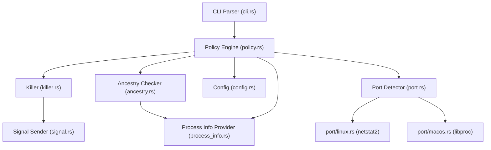

# AGENTS.md

このファイルは、このリポジトリで作業するエージェント向けのガイドです。

## Project Overview

safe-kill は AI エージェント向けの安全なプロセス終了 CLI ツール。ancestry-based access control により、セッションの子孫プロセスのみを終了可能にする。macOS・Linux 対応。

## Commands

開発コマンドは `make help` (引数なしの `make`) で一覧できる。ツールの版は `mise.toml` が正で、Makefile は cargo を `mise exec --` と `--locked` 付きで呼ぶ (Cargo.toml の `rust-version` も mise.toml の rust と同じ major.minor にそろえる)。

```bash
# 準備と CI と同じ検査
make setup              # mise のツールチェーンと依存を取得
make ci                 # fmt-check + lint + test (GitHub Actions の quality ジョブと同じ)

# ビルド
make build              # デバッグビルド
make release            # リリースビルド
make install            # /usr/local/bin にインストール (INSTALL_PATH で変更可)

# テスト
make test               # 全テスト実行 (macOS で lib 512 + bin 58 + E2E 124 + integration 80。lib は OS 固有のテストを含むので Linux では件数が変わる)
make test-e2e           # E2Eテストのみ
make test-integration   # 統合テストのみ
# 直接 cargo test を呼ぶときも SAFE_KILL_ROOT_PID は外す（make のターゲットと同じ。Testing Notes 参照）
mise exec -- env -u SAFE_KILL_ROOT_PID cargo test --locked ancestry               # 特定モジュールのテスト
mise exec -- env -u SAFE_KILL_ROOT_PID cargo test --locked test_is_suicide_self   # 特定テスト名で実行

# リント・フォーマット
make fmt                # cargo fmt (書き換える)
make fmt-check          # 整形済みかの検査 (書き換えない)
make lint               # cargo clippy --all-targets -- -D warnings
make check              # fmt-check + lint
```

## Architecture



### Safety Layers（優先順）

1. **自殺防止**: 自プロセス・親プロセスの kill 禁止。ポリシー判定時の早期拒否（構築時スナップショット）に加え、kill 直前に最新の親 PID を OS から再取得して再検証する（`verify_not_suicide_before_kill`）。判定～kill 間の再ペアレント（親の入れ替わり）に対して fail-closed であり、親 PID が不明な場合も安全側に倒して拒否する
2. **PID検証**: `0` や `i32::MAX` を超える PID は拒否。kill 直前の fresh なプロセス情報取得 (`ProcessInfoProvider::fetch_fresh`) でも同じ境界を公開 API 側で拒否し、OS や `sysinfo` の特殊 PID 解釈に依存しない
3. **Denylist**: システムプロセスは常に保護。照合はプロセス名の完全一致だが、Linux の sysinfo はプロセス名として `/proc/<pid>/stat` の comm（カーネルが先頭 15 バイトに切り詰める）を返すため、16 バイト以上のエントリはそのままでは決して一致しない（`gnome-terminal-server` は `gnome-terminal-` として観測される）。Linux では長いエントリも同じく先頭 15 バイトで切り、UTF-8 の文字の途中で切れた場合は観測名と同じ lossy 変換をした表現で比べる（`config.rs::denylist_entry_matches`）。拒否側の照合なので、切り詰めで別の名前と重なっても保護が広がるだけで安全側に倒れる。allowlist と `--name` は、過剰一致が許可や対象の拡大になるため完全一致のまま扱う
4. **PID 1 保護**: PID 1（init/launchd 相当）自体は常に kill 拒否する。コンテナ環境では PID 1 が `node` / `python` など非標準プロセスとして既定 denylist 外になることがあり、allowlist 一致やポート kill 経路で巻き添えで終了させるとコンテナ全体が落ちるため、ancestry / allowlist 判定より手前で fail-closed する（`can_kill` と `can_kill_for_port` の両方）
5. **Root PID保護**: `SAFE_KILL_ROOT_PID` または自動検出された信頼ルート自体は kill 禁止
6. **Allowlist**: 信頼プロセスは ancestry チェックをバイパス
7. **Ancestry検証**: セッションの子孫のみ kill 可能。信頼ルートの自動検出（`detect_root_pid`）は「エージェント → ツール用シェル → safe-kill」を想定し、親がシェル（`sh` / `bash` / `zsh` / `dash` / `ash` / `ksh` / `ksh93` / `mksh` / `pdksh` / `yash` / `fish` / `tcsh` / `csh`。ログインシェルの `-zsh` 表記も含む）のときだけ祖父（エージェント）を採る。`sh -c 'safe-kill …'` のように単一コマンドを渡すと sh / bash / zsh は fork せず exec するので間のシェルが消え、親がエージェント、祖父がエージェントの起動元（端末のシェルや IDE のプロセス）になる。祖父を無条件に採るとエージェントの兄弟プロセスまで子孫扱いになるため、親がシェルでなければ親（エージェント自身）を信頼ルートにする。候補は PID 0/1 と既定 denylist に載るシステムプロセスを不適格とし（`is_eligible_auto_root`）、不適格ならより内側（親→現在プロセス）へ倒して、外側へは探索しない。PID 1 をルートにすると親チェーンが init に到達する全プロセスが子孫扱いになり、Linux で孤児が付け替えられる subreaper（`systemd --user` など、PID 1 ではない）をルートにするとユーザーセッション全体が子孫扱いになる（どちらも fail-open）。利用者が追加した denylist は保護対象の指定であって信頼ルートの適格性とは別なので含めない。ラッパー（`timeout` / `make` / npm スクリプトなど）経由で起動すると親がラッパーになって範囲が狭まる（fail-closed）ので、その場合は `SAFE_KILL_ROOT_PID` でエージェントの PID を明示する。公開 API の `is_descendant_of` も `ancestor_pid` が 0/1 なら子孫判定を拒否する。木探索本体は `target_pid == ancestor_pid` の同一 PID ケースでも、対象 PID が snapshot に存在しなければ子孫扱いせず fail-closed に倒す。直接の親 PID が祖先と一致する場合も、祖先自体が同じ snapshot に存在することを確認する。さらに `AncestryChecker` は構築時に信頼ルートの初期 identity（`pid + start_time + name`）を保持し、すべての子孫判定 (`is_descendant` / `is_descendant_of` / `is_descendant_fresh`) で identity 同一性を検証する。`is_descendant` / `is_descendant_of` は識別子検証と子孫判定を同一 snapshot 上で行い、kill 直前の `is_descendant_fresh` は親チェーンの往復検証（安全層 9）で、両者の間の TOCTOU 窓を最小化する。`refresh()` で identity 不一致を検出した場合は `root_identity` を `None` 化して以後 fail-closed に倒す（初期 identity を更新しないことで、PID 再利用後のプロセスを信頼ルートとして受け入れない）
8. **PID再利用検出 (TOCTOU 緩和)**: ポリシー判定後、kill 直前に最新のプロセス情報を OS から取得し、`pid + start_time + name` の同一性を再検証する。判定時と異なるプロセスへ PID が再利用されていれば `ProcessNotFound` として fail-closed する。`start_time` は秒精度のため、同一秒内の同名プロセスへの再利用は検出できない（実用上は極めて稀）。完全な保護には Linux の `pidfd_open` + `pidfd_send_signal` が必要だが、現状は窓を大幅に狭めている
9. **kill 直前の ancestry 再評価**: PID/名前指定で `KillPermission::Allowed`（ancestry 経由）で許可されたプロセスは、kill 直前に対象から信頼ルートまでの親チェーンを `fetch_fresh` で 1 プロセスずつ取り直して検証する（`is_descendant_fresh` → `verify_fresh_chain`）。往路で各ノードの identity と親 PID を記録し、到達したルートの identity を構築時の初期 identity と照合したうえで、ルートから対象へ逆順に取り直して identity と親子関係が変わっていないことを確かめる。取得失敗・循環・PID 0/1 到達・深度上限超過は拒否する。判定～kill 間に対象プロセスが再ペアレントされて信頼ルート外に出たケースや、途中の祖先・信頼ルートの PID 再利用を `NotDescendant` として fail-closed する。以前は対象ごとに全プロセスの snapshot を作り直しており（macOS の約 900 プロセスで 1 回約 30ms）、`--name` の一致 200 件で約 6 秒かかっていた。全プロセスの snapshot も OS 全体を一時点で固めたものではないので、チェーンを往復で検証する方が途中の変化を明示的に検出できる。再評価で拒否するときは先に同一性（安全層 8）を確かめ、判定後に終了した・PID が再利用された対象は `NotDescendant`（終了コード 255、「セッション外」）ではなく `ProcessNotFound`（終了コード 1）として返す（消えただけの対象を権限の問題と誤認させない）。`AllowedByAllowlist`（allowlist は ancestry をバイパスする設計）と `--port` kill では設計上 ancestry を適用しないため再評価をバイパスする。`FinalAncestryCheck::try_from_permission` で `Required` / `Bypassed` の区別を型レベルで表現し、拒否系の permission が紛れ込んだ場合は `Err(SystemError)` で fail-loud にする（呼び出し漏れの早期検出）
10. **ポート保持の再検証**: `--port` 指定 kill では、判定～kill の間に対象 PID が当該ポートを離していないかを再取得した保持者集合と照合する。離していれば `NoProcessOnPort` として fail-closed する（既に意図したサービスは停止しているため余計な kill を抑止する）。macOS では対象 PID の FD だけを問い合わせ直し、失敗した FD の問い合わせを保持の証拠に数えない（「Port-based killing の特殊性」参照）
11. **表示時の端末制御文字サニタイズ**: `--list` / kill 結果表示 / エラー出力（stderr の `safe-kill: ...`）/ `safe-kill init` のパス表示 / 設定読み込み警告の各経路で、OS から取得したプロセス名・コマンドライン引数・エラーメッセージ本文・設定パスに含まれる ANSI escape（画面消去・OSC 等）・改行・タブ・その他制御文字・Unicode 17.0 の general category `Cf` に属する全 170 個の format 制御文字（双方向テキスト制御等）・Unicode の改行 U+2028 LINE SEPARATOR / U+2029 PARAGRAPH SEPARATOR を `\xHH` または `\u{HHHH}` のエスケープ表記に置き換えてから出力する（`terminal.rs::sanitize_terminal` / `sanitize_path`）。U+2028 / U+2029 は Cc にも Cf にも属さないが、Python の `str.splitlines()` や JavaScript の行終端子など Unicode を解釈する行分割では行の区切りになるため、素通しすると端末では 1 行に見えても、出力を行単位で読む AI エージェントやスクリプトには偽の `error:` 行を見せられる。`KillResult::failure` の `message` には `NotDescendant(pid, name)` や `Denylisted(name)` のようにプロセス名を含むエラー文字列が保持されるため、`name` だけでなく `message` 側もサニタイズする。stderr へ流れる `SafeKillError` の Display 結果（プロセス名を含むことがある）も `e.to_string()` を介して同様にサニタイズしてから表示する。攻撃者が任意の引数やパスで表示行を上書きする偽装、双方向制御文字による表示順偽装、端末状態の改ざんを防ぐ。サニタイズは `truncate` より前に行い、escape sequence の途中で切られて端末状態が残ることも防ぐ。エスケープ導入文字である `\` 自身も `\\` に置き換える（これを省くと変換が非単射になり、実際に ESC を含むプロセス名と、リテラルで `\x1B[2J` という名前を持つ別プロセスの表示が完全に一致してしまい、どちらが本当に制御文字を含むのか読み手が判別できなくなる）。clap の使用方法エラーも同様にサニタイズする：clap は `invalid value '<値>' for '[PID]'` のように引数値をそのまま文面へ埋め込むが、clap 側に制御文字の除去は無く、`Error::print()` は anstream 経由で生バイトを書き出す。そのため端末直結では `\x1b[2J`（画面消去）や `\r`（行頭復帰による行の上書き）がそのまま画面へ届く（パイプ時だけ anstream が ANSI を落とすので見落としやすい）。`cli.rs::parse_args`（`render_usage_error`）は、同じ argv を全階層のスタイルを `Styles::plain()` にした `Command` で解析し直し、`Error::render().ansi()`（clap 自身の装飾を含まず、引数の文字はすべて残る）を `sanitize_terminal` に通し、`safe-kill: ` を前置して 1 行で stderr へ書く。`StyledStr` の `Display`（`render().to_string()`）は anstream の strip を通すため、引数に含まれていた ESC シーケンスや C0 制御文字までサニタイズの前に削除され、`$'x\a\by'` と `xy` の診断が一致して単射性が崩れる。再解析が想定外に成功した場合は引数を含まない汎用の文言を出す。改行ごとエスケープして畳むのは、描画後の文字列からは「clap 自身のレイアウト改行」と「引数値に含まれていた改行」を区別できないため。行構造を残すと、引数に改行を混ぜるだけで独立した `error:` 行を偽造でき、診断を読む人間や AI エージェントへ、ツール自身の出力として偽の復旧手順（例:「保護設定を外して再実行せよ」）を提示できてしまう。行頭を常に固定接頭辞にすることで、本文側に `error:` が現れても行の出自を誤らない。`--help` / `--version` は clap の色付けを保ったまま `Error::print()` で出すが、これが成立するのは `Command` に `bin_name = "safe-kill"` を明示しているからである。`bin_name` 未設定だと clap は Usage 行へ `argv[0]` の basename を採用し（`name` は表示名を決めるだけでこの経路を塞げない）、制御文字入りの名前を持つ symlink 経由や `exec -a` で起動されると `Usage: fake\rFORGED [OPTIONS] [PID]` のように生の制御文字が help へ載る

12. **スレッド（TID）除外による denylist バイパス防止**: `sysinfo` の `refresh_processes` は既定で `with_tasks()` を含み、Linux では `/proc/<pid>/task/<tid>` のスレッドが独立したプロセスとして一覧に載る（sysinfo 側のコメントも "tasks are considered processes on their own in linux"）。スレッドは `prctl(PR_SET_NAME)` / `pthread_setname_np` で自分の `comm` を自由に変更でき、しかも TID への `kill(2)` はスレッドグループ全体へ配送される。そのため放置すると、denylist に載せたプロセスでも「そのスレッド名」を `--name` に指定すれば名前一致を回避して本体を落とせてしまう。`ProcessInfoProvider` は `without_tasks()` を明示した refresh のみを行い、さらに `ProcessesToUpdate::Some` 指定では tasks 設定に関わらず TID が返るため、参照側でも `thread_kind().is_none()` で一律に弾く（macOS の `proc_listallpids` はプロセスのみ返すため影響なし）

13. **設定ファイル種別の fail-closed 検証**: CLI の厳格読み込みは、設定パス自体が本当に存在しない場合だけ既定値を使用する。通常ファイルと通常ファイルへ解決できる symlink は許可するが、壊れた symlink は「未作成」と誤認せず設定エラーにする。ディレクトリ・FIFO・デバイス等の特殊ファイルも読み込み前に拒否し、管理対象設定の消失によるカスタム denylist の暗黙解除、FIFO での無期限待機、デバイスからの無制限読み込みを防ぐ

14. **設定初期化時の特殊ファイル・パス置換競合対策**: `safe-kill init` は通常ファイルと通常ファイルへ解決できる symlink だけを許可し、ディレクトリ・FIFO・デバイスおよびそれらへの symlink を open 前に拒否する。検証済みの親ディレクトリは device/inode を照合してファイルディスクリプタで固定し、そこから `openat(O_NONBLOCK | O_NOFOLLOW)` で書き込み先を開く。取得したファイルハンドルも通常ファイルかつ検証時と同じ device/inode であることを確認する。検証時に存在しなかったパスは `O_CREAT | O_EXCL` による原子的な新規作成に限定するため、`--force` でも FIFO で無期限に待機したりデバイスへ書き込んだりしない。open 前の symlink・通常ファイル・親ディレクトリ置換は fail-closed で拒否し、open 後の置換でも固定済みFDへの書き込みにより別ファイルへの誘導を防ぐ

15. **設定初期化時の非公開権限**: 新規設定ディレクトリは `DirBuilderExt::mode(0o700)`、新規 `config.toml` は `openat` の mode `0o600` を指定して作成する。作成後の chmod ではなく作成時から権限を制限することで、呼び出し元が `umask 000` でも allowlist・denylist・許可ポートの認可設定を他ユーザーが書き換えられる時間窓を作らない。より厳しい `umask` は維持される

### Port-based killing の特殊性

`--port` は ancestry チェックをバイパスする（孤立した開発サーバー終了用途）。ただし `config.toml` の `[allowed_ports]` で明示的に許可されたポートのみ。未設定時は `--port` オプション自体が無効。ポート `0` は OS の自動割り当て用の特殊値なので、設定に含まれていても常に拒否する。信頼ルート PID 自体はポート指定でも保護する。TCP は LISTEN 状態のソケットのみ対象にし、ESTABLISHED などの接続済みクライアントソケットは対象外。UDP は状態を持たないためローカルポート一致で対象にする。プロセス名解決に失敗した PID は `pid:<pid>` 形式のプレースホルダ名でフォールバックされるが、この名前はあくまで表示用であり、ポリシー判定は fresh なプロセス情報が取れない時点で `ProcessNotFound` として fail-closed する（denylist のバイパス防止）。さらに kill 直前に対象ポートの保持者集合を再取得し、判定時の PID/プロトコルが含まれなければ `NoProcessOnPort` として fail-closed する（判定～kill 間にポートを離した場合の追加防御）。

macOS のポート→PID 解決は netstat2 を使わず、libproc を直接呼ぶ自前実装（`src/port/macos.rs`）で行う。netstat2 0.11.2 の macOS 実装は、`proc_pidfdinfo` が失敗時に -1 ではなく 0 を返す（バッファは書かない）のに `戻り値 < 0` だけを失敗とみなし、書き込まれていないバッファに `MaybeUninit::assume_init` していた（未定義動作。実際には直前の問い合わせ結果が残る）。列挙した後に閉じられた FD に直前のソケットが割り当てられ、ポートを持たないプロセスが `--port` の対象になり、kill 直前の保持確認も同じ関数で走査し直すのですり抜けた（実測で 300 回中 35 回誤選択、5 回は確認も通過）。自前実装は次を守る: 問い合わせごとに 0 初期化した新しいバッファを使う / 戻り値が `sizeof(socket_fdinfo)` と一致したときだけ成功とし、0 以下（errno は直後に読む）と大きさの食い違いではバッファを解釈しない / family・type・protocol・kind・TCP の LISTEN 状態がそろったソケットだけを解釈し、カーネルのデータに `assert!` しない / 列挙後に消えた FD（EBADF・ENOTSOCK・ESRCH）は読み飛ばして証拠に数えず、それ以外の失敗が出た PID は候補にしない / kill 直前の再検証は対象 PID の FD だけを問い合わせ直す（全体を走査しないので軽く、別 PID の情報が混ざる余地もない）。PID 一覧と FD 一覧は件数を検証し、バッファが埋まり切ったら上限付きで広げて取り直す。FFI 定義は `build.rs` が bindgen で macOS SDK（`xcrun --sdk macosx --show-sdk-path`）の `<libproc.h>` / `<sys/proc_info.h>` から生成し、bindgen のレイアウト検査で構造体の形をコンパイル時に照合する（クロスビルドでは clang の `--target` をビルド対象にそろえる）。build-dependencies の target 条件はホストで評価されるので、bindgen を使う `build.rs` のコードはホストの cfg で囲み、生成するかどうかは `CARGO_CFG_TARGET_OS` で決める。macOS 以外のホストから macOS 向けにはビルドできない。Linux は従来どおり netstat2（`src/port/linux.rs`。netlink の sock_diag と `/proc/<pid>/fd`）で、この欠陥の経路は無い。

## Key Modules

| Module | Role |
|--------|------|
| `cli.rs` | clap ベースの CLI 定義と実行モード判定。`init` サブコマンドと通常 kill オプションの排他も担う。`parse_args` は clap 既定の `parse()`（使用方法エラーで `exit(2)`）ではなく、`args_os()` を 1 度だけ集めて `try_parse_from()` を使い、終了コードを自前で決める。2 は `PermissionDenied` に割り当て済みのため、未知フラグや値の形式エラーを 2 で返すと権限エラーと区別できなくなる。clap 由来のエラーは `validate()` の `InvalidUsage` と同じ `GeneralError`(255) に揃え、`--help` / `--version` のみ 0 で終了する。使用方法エラーの表示は `Error::print()` を使わず、`render_usage_error` が plain スタイルで解析し直した `render().ansi()` を `sanitize_terminal` に通し `safe-kill: ` を前置して 1 行で stderr へ書く（clap が引数値を無加工で埋め込むため。上記「表示時の端末制御文字サニタイズ」参照）。`--help` / `--version` は `Error::print()` で色付きのまま出すが、その前提として `#[command(bin_name = "safe-kill")]` を明示する（未設定だと clap が Usage 行へ `argv[0]` を採用し、制御文字入りの名前で起動されたときに help 経由で漏れる）。clap derive の型・フィールド・variant には `///` を書かず、help 文は英語の `help = "…"` / `about = "…"` で明示し、日本語の説明は `//` コメントにする。clap derive は `///` を help に使い、明示した `help` で消えるのは短い help だけで、段落を含む `///` から生まれる `long_help` は残って `--help` で優先される（コメントの日本語化で `--help` が日本語混じりになった退行の原因） |
| `policy.rs` | Kill 許可判定のオーケストレーション。root PID 自体の保護、PID 1 自体の保護（コンテナ環境での巻き添え防止、`can_kill` / `can_kill_for_port` の両経路で fail-closed）、既定 denylist の強制合流、`KillPermission` enum の返却（拒否判定→`SafeKillError` 変換は `KillPermission::to_error` に集約）、kill 直前の最終安全検証 (`verify_final_safety_before_kill` = 自殺防止の再確認 `verify_not_suicide_before_kill` + ancestry の fresh 再評価 (Required 時) + PID 再利用検証 `verify_identity_before_kill`) も担う。ancestry の再評価で拒否するときは先に同一性を確かめ、判定後に終了した対象を `NotDescendant` ではなく `ProcessNotFound` として返す。`FinalAncestryCheck` enum で再評価の Required/Bypassed を型レベルに固定し、`try_from_permission` で拒否系を fail-loud に拒絶する |
| `ancestry.rs` | プロセスツリー検証。`SAFE_KILL_ROOT_PID`（0/1/無効値は無視）、なければ自動検出した PID を信頼ルートとする（`detect_root_pid`: 親がシェルなら祖父、そうでなければ親。PID 0/1 と既定 denylist のシステムプロセスは不適格で、より内側の親→現在プロセスへ倒す。安全層 7）。構築時に信頼ルートの初期 identity を `root_identity: Option<ProcessInfo>` で保持し、`root_identity_matches_in_provider` で同一 snapshot 内に identity 検証を組み込む。`is_descendant` / `is_descendant_of`（ancestor が root_pid 時）/ `is_descendant_fresh` の各経路で identity 整合性を fail-closed 検証する。`is_descendant_fresh` は対象から信頼ルートまでの親チェーンを `fetch_fresh` で取り直し、往復で identity と親子関係を検証する（`verify_fresh_chain`。安全層 9）。全プロセスの snapshot を作らないので、対象ごとのコストは親チェーンの深さに比例する。`detect_root_pid` と `verify_fresh_chain` も参照関数を受け取り、「親がシェルか」「祖父が subreaper か」「取得のたびに結果が変わる（途中の祖先の PID 再利用・再ペアレント・消失）」といった実プロセスでは作れない状況を固定のシナリオで検証する。`refresh()` は identity を更新せず、不一致時に `root_identity = None` にして以後 fail-closed に倒す（PID 再利用後のプロセスを信頼ルートにしない）。木探索本体は `is_descendant_of_with_provider` に分離し、任意 provider snapshot に対して再利用可能。さらにその中身は `is_descendant_of_with_lookup`（`impl Fn(u32) -> Option<ProcessInfo>` を受け取る）として切り出してある。深度上限・親 PID の循環・PID 1 到達といった停止条件は実プロセスツリーでは意図的に作れないため、provider 直結のままでは「ループ条件を壊してもテストが通る」状態になる。固定ツリーを注入して停止条件そのものを検証できるようにしている。同一 PID 指定でも対象 PID が snapshot に存在しなければ子孫扱いせず、直接の親が祖先と一致する場合も祖先が snapshot に存在することを確認する |
| `killer.rs` | シグナル送信と結果追跡。dry-run 対応。`KillResult` に元の `SafeKillError` を保持する |
| `config.rs` | `~/.config/safe-kill/config.toml` の読み込み。CLI 実行ではアクセス不可・解析不能・未知フィールド・壊れた symlink・特殊ファイルを設定エラーとして fail-closed にし、通常ファイルへの symlink は許可する。OS別デフォルト denylist とユーザー denylist を合流。denylist の照合は `denylist_entry_matches` に集約し、Linux では comm の 15 バイト切り詰めを考慮する（安全層 3。allowlist は完全一致）。フォールバック読み込み（ライブラリ API の `load` / `load_from_path`）時の警告は設定パスとエラー本文をサニタイズしてから表示し、書き込みに失敗しても無視して既定値を返す（`eprintln!` は EPIPE などで panic し、「警告を出して既定値を返す」契約が破れるため。書き込み先は `load_from_path_reporting` で差し替えてテストする） |
| `signal.rs` | Unix シグナル解析と送信。名前/番号両対応、macOS/Linux のプラットフォーム固有番号のみ受付、危険 PID 値の拒否 |
| `port.rs` / `port/linux.rs` / `port/macos.rs` | port→PID 解決。TCP は LISTEN のみ、UDP はローカルポート一致、IPv4 と IPv6 の両方。`port.rs` は共通 API（重複排除・PID 昇順・ポート 0 の拒否・表示用の `pid:<pid>`）、`port/linux.rs` は netstat2、`port/macos.rs` は libproc を直接呼ぶ自前実装（FFI 定義は `build.rs` が bindgen で SDK から生成。上記「Port-based killing の特殊性」参照）。libproc の呼び出しは `Libproc` トレイトで差し替えられ、失敗した問い合わせ・大きさの食い違い・前回の内容が残ったバッファ・列挙後の FD の消失を注入してテストする。Linux / macOS 以外では `--port` は検出エラー、再検証は常に不成立 |
| `process_info.rs` | sysinfo ベースのプロセス一覧取得とプロセス名の完全一致検索。`ProcessInfo.start_time` で PID 再利用を検出可能。`fetch_fresh(pid)` は PID 0 と `i32::MAX` 超過を拒否した上で新しい `System` を作り、指定 PID のみ refresh する TOCTOU 検証専用関数。結果は PID 昇順で安定化。refresh は `refresh_kind()`（`without_tasks()` 指定）で行い、Linux のスレッド（TID）を一覧に入れない（下記「スレッド経由の denylist バイパス防止」参照）。参照側（`get` / `find_by_name` / `all` / `fetch_fresh`）でも `thread_kind().is_none()` で二重に弾く |
| `init.rs` | `safe-kill init` で config.toml を生成。既存ファイルの上書き確認を行い、ユーザーが拒否した場合は作成失敗（終了コード3）ではなく正常な no-op（終了コード0、`InitOutcome::SkippedExisting`）として扱う。確認プロンプトの設定パスはサニタイズ済みで表示する。既存判定は `Path::exists()` ではなく `fs::symlink_metadata()` で行い、symlink の場合は `canonicalize()` で実体を解決してプロンプトと結果表示の両方に開示する。壊れた symlink、特殊ファイル、特殊ファイルへ解決される symlink は fail-closed で拒否する（`--force` でも同様）。親ディレクトリを device/inode 検証済みのFDで固定して `openat(O_NONBLOCK | O_NOFOLLOW)` を行い、既存ファイルの device/inode も再検証する。未作成パスは `O_CREAT | O_EXCL` に限定し、検証～書き込み間のパス置換競合を拒否する。新規ディレクトリは `0700`、新規設定ファイルは `0600` の権限上限を作成時に指定し、緩い umask でも認可設定を他ユーザーへ公開しない |
| `error.rs` | thiserror ベースのエラー型と終了コード (0/1/2/3/4/255)。1 は「指定した対象が見つからない」専用で、対象未指定（`NoTarget`。`safe-kill` だけ、`safe-kill --dry-run`、空の `$PID` を引用符なしで渡した場合など）は他の使用方法エラーと同じ 255 にする（1 にすると「対象はもう終了している」と誤読される） |
| `terminal.rs` | 端末表示用サニタイズ。ANSI escape・改行・タブ・C0/C1 制御文字・Unicode 17.0 の `Cf` 全 170 文字・Unicode の改行 U+2028 / U+2029（Cc にも Cf にも属さないが、`splitlines()` など Unicode を解釈する行分割では行の区切りになる）を表示用エスケープへ置換し、プロセス情報・エラー本文・設定パスの表示偽装を防ぐ。エスケープ導入文字 `\` 自身も `\\` へ置換して変換の単射性を保つ。改行も例外なくエスケープするので、複数行の文面（clap の使用方法エラー）は 1 行へ畳まれる。これは意図した挙動で、行構造を残すと引数由来の改行だけで診断行を偽造できるため |
| `main.rs` | CLI のエントリポイント。実行モードごとの分岐、終了コード変換、表示出力を担う。`terminal.rs` のサニタイズを使い、`--list` 出力、kill 結果表示（`print_kill_result` の `name` と `message` の両方）、`main()` での stderr エラー出力、`safe-kill init` の生成/スキップパス表示にサニタイズ済み文字列のみを流す。表示関数（`write_kill_result` / `write_killable_list` / `write_domain_error` / `write_output_failure` / `write_report_lost_warning`）は `&mut impl Write` を受け取り、`Vec<u8>` に書かせて実際の出力経路のサニタイズを検証する。表示の失敗は出力の役割（`OutputRole`）で扱いを分ける。BrokenPipe はどちらも成功扱い。それ以外の書き込み失敗は、`--list` とすべての dry-run（`Required`。出力そのものが成果物）なら 255、実際の kill と init の結果（`Informational`。操作は完了済み）なら stderr に警告を 1 行出して 0（0 以外にすると成功した kill を呼び出し側がやり直したり強めたりしかねない）。ドメインエラーは常に表示の結果より優先する |

## Versioning

YY.M.COUNTER 形式（例: 26.1.105。採番は JST）。リリースは GitHub Actions の workflow_dispatch で実行（Actions → Release → Run workflow。まず dry_run で次の版を確かめる）。添付は `safe-kill-<target>.tar.gz`（x86_64-unknown-linux-gnu / aarch64-apple-darwin / x86_64-apple-darwin）と `SHA256SUMS`。

## Testing Notes

- E2E テストは `assert_cmd` を使用し、実際のバイナリを実行する
- 統合テストは実プロセスツリーを使ったテスト
- 統合テストの一意なプロセス名はテストランナーの PID と連番から生成し、Linux の `comm` 15 バイト上限内に収める。これにより複数の `cargo test` を並行実行しても名前が衝突しない
- ancestry テストでは `SAFE_KILL_ROOT_PID` 環境変数でルート PID を制御可能（`0`・`1` や無効値は無視、root PID 自体は kill 不可）
- E2E テストは `safe_kill()` / `safe_kill_std()` ヘルパー経由でバイナリを起動する。HOME を空のディレクトリ（`$CARGO_TARGET_TMPDIR/e2e-empty-home`、mode 0555）へ向け、`SAFE_KILL_ROOT_PID` と `CLICOLOR_FORCE` を外す。開発者の `~/.config/safe-kill/config.toml`（`allowed_ports` に開発用ポートを入れている等）や環境変数で、結果が変わったり実際の kill が起きたりしないようにするため。設定が要るテストは一時 HOME に `config.toml` を書いて `.env("HOME", …)` で上書きする
- ライブラリと統合テストは同じプロセス内で環境変数を読む。並列に走るテストの中で `std::env::set_var` / `remove_var` を使うとデータ競合になるので使わない。`make test` 系のターゲットは `env -u SAFE_KILL_ROOT_PID` で起動する。単体テストは `PolicyEngine::with_defaults()`（実 HOME の設定を読む）ではなく `PolicyEngine::new(Config::default())` か明示的な `Config` を使う
- `--port` / `kill_by_port` は ancestry を通らない。テスト自身が bind したソケットを持つ子プロセスを対象にする場合を除き、必ず dry-run で検証する（空きと仮定したポートでも、他のアプリが一時ポートとして UDP で使っていれば実際に kill してしまう）。実 kill するテストも、先に dry-run で一致した PID が自分の子だけであることを確かめる
- 回収（`wait`）済みの PID にはシグナルを送らない（再利用されていれば無関係なプロセスに届く）。終了の確認は `ExitStatusExt::signal()` で行う。dry-run の結果だけを見るテストで固定 PID を使うときは、実在しない `999999999` を使う。後始末に `pkill` / `kill` は使わず、所有する `Child` を `kill()` + `wait()` する
