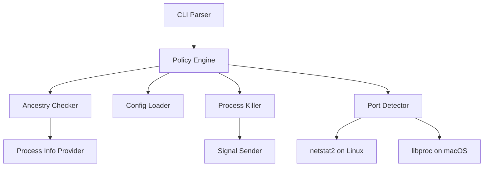

# Architecture

How `safe-kill` decides whether a process may be killed, and the checks it runs before and while sending a signal. Which processes end up killable is shown in the README's [What Can Be Killed](../README.md#what-can-be-killed).

## Components

## Safety Layers

1. **Suicide Prevention**: Cannot kill own process or parent. Beyond the early policy-time check, the current parent PID is re-resolved from the OS immediately before `kill(2)`, failing closed against re-parenting between the policy decision and signal dispatch (and also when the parent PID is unknown)
2. **PID Validation**: Reject unsafe PID values (`0`, out-of-range) before signal dispatch. The fresh process lookup used for pre-kill TOCTOU checks also rejects PID `0` and values beyond `i32::MAX` before consulting the OS process snapshot.
3. **Denylist Check**: System processes are always protected. Matching is exact, except that on Linux sysinfo reports a process name as its `comm` from `/proc/<pid>/stat`, which the kernel truncates to the first 15 bytes — an entry such as `gnome-terminal-server` would otherwise never match the observed `gnome-terminal-`. On Linux, an entry longer than 15 bytes is therefore also compared after the same truncation (with the same lossy UTF-8 decoding when the cut falls inside a character). Over-matching only widens protection, so this errs on the safe side; the allowlist and `--name` stay exact because there over-matching would widen what can be killed.
4. **PID 1 Protection**: PID 1 (init/launchd, or a custom container entrypoint) is always refused as a kill target, ahead of ancestry / allowlist evaluation, in both `can_kill` and `can_kill_for_port`. Containers often run a non-standard PID 1 (e.g. `node`, `python`) that is not on the default denylist — without this guard an allowlist match or `--port` kill would take down the whole container.
5. **Root PID Protection**: The trust root itself is not killable, even if allowlisted
6. **Allowlist Bypass**: Trusted processes can skip ancestry checks
7. **Ancestry Verification**: Only descendants of the trust root are killable. Auto-detection assumes `agent → tool shell → safe-kill` and takes the grandparent (the agent) only when the direct parent is a shell (`sh`, `bash`, `zsh`, `dash`, `ash`, `ksh`, `ksh93`, `mksh`, `pdksh`, `yash`, `fish`, `tcsh`, `csh`, including a login shell's `-zsh` form). When an agent runs a single command with `sh -c 'safe-kill …'`, sh/bash/zsh exec it instead of forking, so the shell disappears: the parent is the agent itself and the grandparent is whatever launched the agent (a terminal shell, an IDE process). Always taking the grandparent would make the agent's siblings killable, so when the parent is not a shell, the parent becomes the root. PID 0/1 and processes named on the built-in denylist are never eligible, and an ineligible candidate falls back inward (parent → current process), never outward: PID 1 as the root would make every process a descendant, and on Linux an orphan is re-parented to the nearest subreaper (e.g. `systemd --user`, which is not PID 1), which would make the whole user session a descendant. User-added denylist entries do not affect eligibility. Running safe-kill through a wrapper (`timeout`, `make`, an npm script) makes the wrapper the parent and narrows the scope; set `SAFE_KILL_ROOT_PID` to the agent's PID in that case. The trust root's initial identity (`pid + start_time + name`) is captured at construction and re-validated on every descendant check. Identity verification and ancestry traversal run on the same provider snapshot (and the pre-kill re-check validates the chain twice, see layer 9) to minimize the TOCTOU window between them; `refresh()` does not update the identity (a refreshed identity would silently trust a process that reused the root PID). Low-level ancestry traversal requires the target PID to exist before accepting the reflexive `target == ancestor` case. It also verifies that a matching direct ancestor exists in the same snapshot; a stale parent PID alone does not establish ancestry.
8. **PID Reuse Detection (TOCTOU mitigation)**: Re-validates `pid + start_time + name` immediately before `kill(2)`. If the OS has reused the PID for another process between policy decision and signal dispatch, the kill fails closed with `ProcessNotFound`. The `start_time` granularity is seconds, so reuse to a same-named process within the same second cannot be detected (extremely rare in practice). Full coverage would require Linux `pidfd_open` + `pidfd_send_signal`.
9. **Pre-kill Ancestry Re-check**: For PID/name kills authorized via ancestry (`KillPermission::Allowed`), the parent chain from the target up to the trust root is re-read from the OS one process at a time right before `kill(2)`. Each node's identity and parent PID are recorded on the way up, the root's identity is compared with the one captured at construction, and the chain is then re-read from the root back down to the target to confirm that no identity or parent link changed. A failed lookup, a cycle, reaching PID 0/1, or exceeding the depth limit is a refusal. This catches a target that was re-parented out of the trust root between the policy decision and signal dispatch, as well as PID reuse of an intermediate ancestor or of the root, failing closed with `NotDescendant`. Re-reading only the chain keeps the cost proportional to its depth: taking a full process snapshot per target cost about 30 ms on a macOS host with ~900 processes, so `--name` with 200 matches took about 6 s, and a full snapshot is not an atomic picture of the system either. When the re-check refuses, the target's identity is verified first, so a target that merely exited (or whose PID was reused) after the policy decision reports `ProcessNotFound` (exit 1) rather than `NotDescendant` (exit 255). Allowlist (`AllowedByAllowlist`) and `--port` kills intentionally bypass ancestry by design, so the re-check is skipped for them.
10. **Port Hold Re-check (port mode only)**: For `--port` kills, the set of current holders of the target port is re-queried just before signaling. If the candidate PID/protocol is no longer present in that set (the target released the port between policy decision and `kill(2)`), the kill fails closed with `NoProcessOnPort`. This avoids killing a now-unrelated workload that happens to share the same PID after the user's intent (releasing the port) has already been satisfied. On macOS the re-check re-queries only the candidate PID's own descriptors, and a failed descriptor query never counts as evidence (see [Port Detection Backends](#port-detection-backends)).
11. **Terminal Output Sanitization**: Process names, command-line arguments, error message bodies, and config paths are escaped (`\n`, `\r`, `\t`, `\xHH`, `\u{HHHH}`) before they reach the terminal, including all 170 Unicode 17.0 general-category `Cf` format controls and the Unicode line breaks U+2028 LINE SEPARATOR / U+2029 PARAGRAPH SEPARATOR (neither `Cc` nor `Cf`, but Unicode-aware line splitting such as Python's `str.splitlines()` treats them as line ends, so an unescaped one would let an AI agent reading the output line by line see a forged `error:` line). This applies to `--list`, kill result lines (both the `name` column and the `message` column, since `KillResult::failure` stores `error.to_string()` which can embed the offending process name via `NotDescendant(pid, name)` / `Denylisted(name)`), the stderr error line emitted by `main()` (`safe-kill: ...`), `safe-kill init` created/skipped path output, overwrite prompts, and config-load warnings. Crafted argv or paths containing ANSI escape sequences, OSC sequences, newlines, or bidirectional Unicode controls cannot rewrite, hide, or visually reorder rows of output, and escape sequences cannot be cut mid-byte by the column-width truncation logic. The escape introducer `\` is itself escaped to `\\`, which keeps the transformation injective — without it, a process genuinely containing an ESC byte and a process literally named `\x1B[2J` would render identically, so a reader could not tell which one actually carries a control character.

    Clap usage errors are sanitized on the same principle. Clap embeds the offending argument verbatim (`invalid value '<value>' for '[PID]'`), performs no control-character removal of its own, and `Error::print()` writes raw bytes through `anstream` — so on a terminal, `\x1b[2J` (clear screen) or `\r` (carriage return, overwriting the line in place) reaches the screen unchanged. Only when the output is piped does `anstream` strip ANSI, which makes the gap easy to miss. `parse_args` therefore re-parses the same argv with a `Command` whose styles are `Styles::plain()` at every level and takes `Error::render().ansi()`, which carries no clap styling but keeps every character of the argument. It passes that through `sanitize_terminal` and writes it as a single `safe-kill: ...` line. `StyledStr`'s `Display` is not used: it runs `anstream`'s stripper, which also deletes the argument's own ESC sequences and C0 controls before sanitization, so `$'x\a\by'` and `xy` would produce identical diagnostics and the reader could not tell that the argument carried control characters. Newlines are escaped along with everything else because a rendered string no longer distinguishes clap's own layout breaks from newlines that came in through an argument — keeping the line structure would let an argument forge a standalone `error:` line and present a fake recovery instruction ("disable the protection and retry") as the tool's own diagnostic. `--help` and `--version` keep clap's coloring, which is only safe because `Command` sets `bin_name = "safe-kill"`: without it clap uses the basename of `argv[0]` in the usage line (`name` does not cover this), so launching through a symlink whose name contains control characters — or via `exec -a` — would print `Usage: fake\rFORGED [OPTIONS] [PID]` with the raw bytes intact.

12. **Thread (TID) Exclusion**: `sysinfo` enumerates process tasks by default, so on Linux every `/proc/<pid>/task/<tid>` thread would show up as a process in its own right. Threads can rename themselves freely via `prctl(PR_SET_NAME)` / `pthread_setname_np`, and `kill(2)` on a TID is delivered to the whole thread group — so without this guard, a denylisted process could be taken down by passing one of *its threads'* names to `--name`, sidestepping the denylist entirely. The process snapshot is refreshed with `without_tasks()`, and because `ProcessesToUpdate::Some` returns a TID regardless of that setting, every read path additionally rejects entries with `thread_kind().is_some()`. macOS is unaffected (`proc_listallpids` returns processes only).

13. **Configuration File Type and Write Validation**: Strict configuration loading and `safe-kill init` accept only regular files or symlinks resolving to regular files. Dangling symlinks and special files are rejected before I/O. During initialization, the validated parent directory is pinned after a device/inode check, and the destination is opened relative to that directory descriptor with `openat(O_NONBLOCK | O_NOFOLLOW)`. The opened regular file's device/inode is checked before truncation, while a path absent during validation is limited to atomic `O_CREAT | O_EXCL` creation. FIFO hangs and device writes are rejected; symlink, regular-file, or parent-directory replacement before open fails closed, and replacement after open cannot redirect the pinned file descriptor.

14. **Private Configuration Permissions**: A newly created configuration directory is limited to mode `0700`, and a new `config.toml` to mode `0600`. The modes are supplied at creation time, so even `umask 000` cannot expose allowlist, denylist, or allowed-port policy to modification by other users.

## Port Detection Backends

`--port` resolves which processes hold a port with a per-OS backend. Both treat only TCP sockets in `LISTEN` state and UDP sockets bound to the local port as holders, for IPv4 and IPv6.

- **Linux** uses the netstat2 crate, which reads the socket table through netlink `sock_diag` and maps socket inodes to PIDs via `/proc/<pid>/fd`.
- **macOS** calls libproc (`proc_listallpids`, `proc_pidinfo(PROC_PIDLISTFDS)`, `proc_pidfdinfo(PROC_PIDFDSOCKETINFO)`) directly instead of using netstat2. netstat2 0.11.2 treated only a negative return value of `proc_pidfdinfo` as failure, but the call returns `0` on failure without writing the buffer; netstat2 then read the unwritten buffer (`MaybeUninit::assume_init`, undefined behavior) and in practice reported the previous query's socket for the next descriptor. When a descriptor closed between enumeration and query, a process that never bound the port was reported as its holder, and because the pre-kill re-check rescanned with the same function, the mistake could survive it (measured: 35 of 300 runs picked such a process, 5 of them passed the re-check). The macOS backend:
  - starts every query from a zero-initialized buffer and accepts a result only when the return value equals `sizeof(struct socket_fdinfo)`; `0`, negative values (with `errno` captured right after the call), and any other size are failures, and the buffer is not interpreted;
  - interprets a socket only when family, type, protocol, kind, and (for TCP) the `LISTEN` state all agree, and never asserts on kernel data;
  - skips a descriptor that disappeared after enumeration (`EBADF`, `ENOTSOCK`, `ESRCH`) without counting it as evidence, and drops a process from the candidates on any other failure;
  - validates the PID and descriptor lists against their element sizes and regrows the buffers, up to a bound, when a list fills them;
  - re-checks only the candidate PID's descriptors right before `kill(2)`.

  The FFI definitions are generated by `build.rs` with bindgen from the macOS SDK headers (`<libproc.h>`, `<sys/proc_info.h>`, located with `xcrun --sdk macosx --show-sdk-path`), and bindgen's layout assertions compare every struct size and field offset with the SDK at compile time. Building for macOS therefore requires Xcode or the Command Line Tools on a macOS host.
